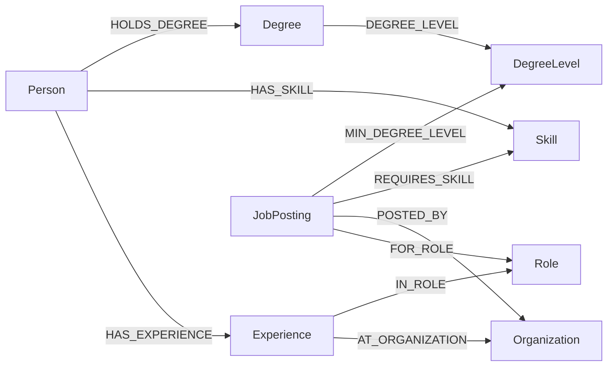

# Data Extraction

Local Flask backend for resume/job extraction stages 1-5 and Pydantic validation in stage 7. The implementation is
under review; LLM fallback, SHACL validation, Neo4j publishing and matching are deferred.

This directory contains the pipeline-specific Python modules and O*NET importer.
The shared application facilitator lives one level above, in [app.py](../app.py).
The on-disk directory is named `data-extraction`; its Python import path is
`career_coach.data_extraction`, registered by the parent package so imports and
entry points use valid Python identifiers. Relative imports stay inside this package.
All commands below run from the repository root, not this directory.

## Pipeline Diagram


| Stage | Implemented behavior |
| --- | --- |
| 1. Ingest/archive | File uploads, Jobicy discovery, local CSV/XLSX adapters, immutable raw blobs, document revisions and processing runs |
| 2. Parse | Digital PDF, DOCX body paragraphs/tables, HTML, UTF-8 text and structured Jobicy descriptions |
| 3. Structure | Sections including inline headings, bullets, date ranges, duration/degree mentions and paragraph entries |
| 4. Extract | Fixed GLiNER, source-field/rule mentions, skill/credential claims, job requirements and evidence-bearing relationships |
| 5. Normalize | Pinned O*NET aliases, lexical/contextual candidate ranking, optional local embeddings, explicit ambiguity and source namespaces |
| 7. Validate | Pydantic ontology models, schema/evidence/reference checks, taxonomy checks, and separate versioned reports |

## Module organization

``` powershell
├── models.py # Extraction contracts and PostgreSQL metadata
├── storage.py # Raw archive, document identities and revisions
├── sources.py # Jobicy and local dataset adapters
├── pipeline.py # Parsing, structural rules, GLiNER and relationship assembly
├── taxonomy.py # O*NET candidate retrieval and normalization
├── validation.py # Ontology-guided Pydantic models and stage 7 validation
└── import_onet.py # Download/rebuild the pinned taxonomy lookups
```

The Flask application target is `career_coach.app:create_app`;
the worker target is `career_coach.app:celery`. The `career-coach`
CLI remains the same. After changing package entry points locally, run `uv sync`
to refresh the installed console commands.

To refresh or rebuild the taxonomy, use `uv run career-coach-import-onet --download`
(omit `--download` for an offline rebuild). Full import details and attribution are
in the [taxonomy guide](../../../data/taxonomy/README.md).

## Docker setup

Docker Desktop must be running with Linux containers. The project uses uv and the
existing `uv.lock` inside the image; your Windows `.venv` is excluded from the build.
You do not need to install PostgreSQL or RabbitMQ on Windows.

From PowerShell in the repository root:

```powershell
# Optional: copy once to customize the defaults. Do not overwrite an existing .env.
Copy-Item .env.example .env
docker compose config --quiet
docker compose up --build -d
docker compose ps -a
Invoke-RestMethod http://localhost:5000/health
```

| Service | Purpose |
| --- | --- |
| postgres | Document identities, revisions, extraction runs and ingestion state |
| rabbitmq | Celery task broker |
| init-db | One-shot creation of the initial schema; successful exit is expected |
| api | Flask review API, published only at `http://localhost:5000` |
| worker | Background pipeline tasks, one process to bound model memory |

Compose waits for database/broker health and successful schema initialization before
starting the application. The initial schema command creates missing tables; it is
not a migration system for future schema changes. Neo4j is not needed until graph
projection is implemented. This is a local development server without authentication.

Named volumes preserve PostgreSQL, RabbitMQ, raw documents and model caches:

```powershell
docker compose stop
docker compose start

# Remove containers/network while retaining data volumes:
docker compose down
```

Do not add `--volumes` to `down` unless you intend to delete stored data. Changing
database/broker passwords in `.env` does not rotate credentials in existing volumes.
Default image tags pin major versions rather than immutable digests; dependency
installation uses the lockfile. No container downloads model weights during a build.

## GLiNER extraction

GLiNER is installed as a required dependency and runs after the structural rules on
every extraction. The model (`urchade/gliner_small-v2.1`), immutable revision and
entity score threshold (`0.5`) are fixed directly in `pipeline.py`. There are no
extraction-mode, model-selection or model-threshold request/environment settings.
The baseline uses CPU-only PyTorch wheels on Windows/Linux; no GPU setup is required.

The worker downloads the fixed model on its first extraction and reuses the named
model-cache volume and its in-memory instance afterward. The first job therefore
needs internet access and takes longer. Download/loading failures fail the run;
they do not produce a partial rules-only result. To populate the cache beforehand:

```powershell
docker compose run --rm --no-deps worker career-coach warm-model
```

For local development, `uv sync` includes GLiNER. Embedding lookup is independently
optional: install `uv sync --extra embeddings`, provide a complete local
SentenceTransformers model and set `EMBEDDING_MODEL_PATH` to its directory. For Docker,
add `--extra embeddings` to the Dockerfile's `uv sync` command and supply the model in
the model volume. No separate vector database or persistent vector index is created
at these stages.

## API review

```powershell
curl.exe -X POST http://localhost:5000/documents -F "file=@C:/path/to/resume.pdf" -F "kind=resume" -F "external_id=sample-resume-1"
Invoke-RestMethod http://localhost:5000/runs/REPLACE_WITH_RUN_ID | ConvertTo-Json -Depth 30
Invoke-RestMethod http://localhost:5000/documents/REPLACE_WITH_DOCUMENT_ID | ConvertTo-Json -Depth 10
Invoke-RestMethod http://localhost:5000/runs?limit=20 | ConvertTo-Json -Depth 10
```

Supported uploads: digital PDF, DOCX body paragraphs/tables, UTF-8 TXT and HTML.
Use `kind=job` for local postings. Reusing an upload `external_id` creates revisions
under one document identity; unchanged latest content creates a new extraction run.
The response reports whether dispatch succeeded. PostgreSQL retains queued IDs during
broker outages; use `docker compose run --rm api career-coach dispatch-pending` to retry.
Download archived source bytes with
`GET /documents/DOCUMENT_ID/versions/VERSION_ID/raw`. Create a new run from archived
bytes with `POST /runs/RUN_ID/reprocess` (no body); previous results remain unchanged.

```powershell
Invoke-RestMethod -Method Post -Uri http://localhost:5000/ingestions/jobicy -ContentType application/json -Body '{"count":100,"max_pages":5,"geo":"usa"}'
Invoke-RestMethod http://localhost:5000/ingestions/REPLACE_WITH_SYNC_ID | ConvertTo-Json -Depth 10
```

Jobicy syncs are manual and limited to one pass per hour, retain original responses,
and preserve partially imported records on failure. A job leaving the seven-day feed
is not marked closed. Preserve provider attribution and canonical URLs when displaying
postings; see [Jobicy's API terms](https://github.com/Jobicy/remote-jobs-api).

## Local datasets

Download your datasets separately and unzip archives first. The single
`ingest-dataset` command handles both CSV and XLSX, with explicit text/identity
columns rather than guessed field mappings. Example resume dataset import (adjust
column names to the file's header):

```powershell
docker compose run --rm --no-deps --volume C:/datasets:/datasets:ro api career-coach ingest-dataset /datasets/Resume.csv --kind resume --source resumes --text-column Resume_str --id-column ID --limit 20
```

For jobs, use `--kind job` and the description column. For HTML fields, add
`--format html`. For XLSX, pass its path and optionally `--sheet SheetName`.
XLSX formulas use existing cached values; no recalculation is performed.

The importer streams and archives the complete original dataset, then archives
individual selected text fields. Each run points back to the original hash, record
number, text column and worksheet. It emits run IDs for review. Records imported
before a malformed row remain available, and the command reports a partial failure.
Use a stable `--source` and ID column for repeat imports; without an ID column,
record numbers are identities and reordering the dataset changes their meaning.
Dataset imports perform extraction only; they do not evaluate extraction quality.

## Output and current boundaries

Results include the saved parser text/hash, page/line blocks, entity mentions,
paragraph entries, skill/credential claims, job requirements, evidence-bearing
relationships, O*NET candidates and processing provenance. Schema/pipeline version
is `0.2.0`.

## Pydantic validation (stage 7)

`validation.py` defines `Person`, `Organization`, `Role`, `Skill`, `Experience`,
`Degree`, `DegreeLevel` and `JobPosting` using
[`resume-job.ttl`](../../../data/ontologies/resume-job.ttl) as the guide. Python fields
use snake_case and serialize ontology properties such as `hasExperience`,
`requiresSkill`, `degreeLevel` and `atOrganization` through aliases. Object properties
are lists because the supplied ontology declares no maximum cardinality. Unknown
optional values remain absent/empty or null. Degree ranks and experience totals are
not inferred from labels or dates. Non-negative, finite experience years is an
additional application constraint; the ontology itself declares `xsd:float`.

These Pydantic models implement an application contract. They do not parse OWL
axioms, perform reasoning or claim SHACL conformance. The ontology file is unchanged;
manual model updates are required when its vocabulary changes. No RDF/SHACL or LLM
dependency was added.

Every newly completed extraction is saved before validation. Validation then checks:

- Strict serialized schema and supported version, including missing/unknown fields.
- Unique IDs, valid references, document scope and relationship endpoint types.
- Saved-text hashes, Unicode character offsets, exact mention text and evidence coverage.
- Consistent blocks, entries, assertion polarity and scoped duration references.
- Candidate namespaces/IDs/labels/releases against the pinned O*NET data and exact-link eligibility.
- Method-specific finite score bounds: confidence/lexical scores are 0-1; embedding
  cosine scores may range from -1 to 1.

The raw extraction is never rewritten to make it pass. Its historical
`stages_1_to_5_unvalidated` scope describes that artifact; the separate validation
report gives the current validation outcome. An extraction status of `completed`
does not imply validation passed.

| Validation status | Meaning |
| --- | --- |
| `valid` | All implemented structural and reference checks pass |
| `needs_review` | Structural checks pass, but mappings/associations or unsupported ontology context remain |
| `invalid` | Schema, evidence, references or taxonomy selections violate the contract |
| `error` | Validator execution or reference-data loading could not complete |

Reports include validator version, input/ontology/model-schema/taxonomy fingerprints,
findings and an ontology-shaped JSON view when no hard errors are present. That view
contains supported positive extracted assertions, not verified real-world facts.
Preferred, negated, alternative and unsupported requirements remain in the original
records; they are not converted into unconditional `requiresSkill` links. The
current ontology has no Certification class, so those claims are retained for review.
The original extraction always preserves information outside the ontology view.

Reports are append-only rows in the new `validation_reports` table. The existing
`init-db` step creates this additional table on deployment without changing existing
tables or deleting extraction history. Rebuild/start with `docker compose up --build -d`
before using the new endpoints.

For an existing completed run, validate saved JSON without rerunning parsing,
GLiNER or normalization:

```powershell
$report = Invoke-RestMethod -Method Post -Uri http://localhost:5000/runs/REPLACE_WITH_RUN_ID/validate
$report.status
$report.findings | Format-Table severity, code, path, message -AutoSize
$report.ontology_data | ConvertTo-Json -Depth 20
```

`GET /runs/RUN_ID` includes the latest `validation` and `validation_id` alongside
the original result. `GET /runs/RUN_ID/validations` returns the 20 most recent reports.
Repeated validation creates a new report while preserving previous ones. It does
not repair, retrain, evaluate extraction accuracy or publish a knowledge graph.

## Neo4j graph schema

The initial graph schema is [data/graph/schema.cypher](../../../data/graph/schema.cypher).
It mirrors the eight ontology classes and ten object properties, with relationship
names translated to Neo4j's uppercase convention. The namespace remains
`http://example.org/jobmatch#`; Pydantic's camelCase properties map as follows:

| Ontology property | Source label | Relationship | Target label |
| --- | --- | --- | --- |
| `hasExperience` | Person | HAS_EXPERIENCE | Experience |
| `hasSkill` | Person | HAS_SKILL | Skill |
| `holdsDegree` | Person | HOLDS_DEGREE | Degree |
| `atOrganization` | Experience | AT_ORGANIZATION | Organization |
| `inRole` | Experience | IN_ROLE | Role |
| `degreeLevel` | Degree | DEGREE_LEVEL | DegreeLevel |
| `forRole` | JobPosting | FOR_ROLE | Role |
| `postedBy` | JobPosting | POSTED_BY | Organization |
| `requiresSkill` | JobPosting | REQUIRES_SKILL | Skill |
| `minDegreeLevel` | JobPosting | MIN_DEGREE_LEVEL | DegreeLevel |



Datatype properties stay on their owning nodes, using ontology names:
`DegreeLevel.rank` is an integer, `Experience.yearsExperience` and
`JobPosting.minExperience` are finite non-negative floats. The latter bounds are
application rules already enforced by Pydantic. Unknown values remain absent; no
default degree rank or experience duration is assigned. `label` is optional display
metadata, not an identity key.

### Identity, provenance and normalization contract

The future projector must use these rules when constructing data. The Cypher file
installs uniqueness constraints and indexes; it does not implement the projector.

- Each domain node has its ontology label plus `OntologyEntity`, an `ontology_class`
  IRI, `source_id` from `ValidationReport.ontology_data`, and `validation_id`.
  Its graph `id` is `validation_id + ':' + source_id`. Thus reapplying one report
  preserves identities, while a later report cannot overwrite an older snapshot.
  `run_id`, `document_id` and `document_version_id` identify its PostgreSQL origin.
- `Document`, `DocumentVersion`, `ExtractionRun` and `ValidationReport` support nodes
  use the corresponding PostgreSQL row IDs. Their lineage is
  `(Document)-[:HAS_VERSION]->(DocumentVersion)-[:HAS_EXTRACTION]->(ExtractionRun)`
  and `(ExtractionRun)-[:HAS_VALIDATION]->(ValidationReport)`.
  `(ValidationReport)-[:CONTAINS]->(OntologyEntity)` identifies snapshot members.
  Copy report status, validator version and source fingerprints for traceability.
- Evidence lists become `(OntologyEntity)-[:SUPPORTED_BY]->(Evidence)` relationships,
  rather than nested Neo4j properties. Each evidence node retains `mention_id`,
  `start`, `end`, `run_id`, `document_version_id` and the saved text's `text_sha256`.
  Its ID is SHA-256 of the compact JSON array `[run_id, mention_id, start, end]`
  (UTF-8, separators `,` and `:`). `(Evidence)-[:IN_VERSION]->(DocumentVersion)`
  anchors half-open Python Unicode offsets to their source. Full document text and
  original files remain in PostgreSQL/the archive.
- `TaxonomyConcept` nodes use the composite identity `(namespace, code, version)`.
  `code` is the canonical ID from the existing normalization result; local software
  IDs keep their `local:onet-software` namespace. A supported exact link becomes
  `(Role|Skill)-[:NORMALIZED_TO]->(TaxonomyConcept)` using its source mention's
  resolution. Different resume/job mentions can then meet at the same canonical
  concept without being merged by spelling. Preserve the canonical label and the
  mapping method on the concept/relationship as appropriate.
- Initial projection eligibility is a `valid` validation report whose extraction
  fingerprint still matches PostgreSQL. Reports marked `needs_review`, `invalid`
  or `error` are not automatically eligible. Preferred, negated and alternative
  requirements are not converted into unconditional `REQUIRES_SKILL` edges.
  Historical snapshots must be selected explicitly for queries until an activation
  policy is implemented; matching must not accidentally count all revisions.
- Do not merge people, organizations, roles or skills by display label. Person nodes
  currently describe a document snapshot, not a cross-resume identity resolution.
  Merge canonical taxonomy concepts only by their full namespace/code/release key.

Neo4j Community enforces the 14 supplied uniqueness constraints and two additional
lookup indexes. Uniqueness constraints do not require a property to exist. Required
fields, property types, edge endpoints, duplicate edges, cardinality and evidence
checks remain application responsibilities; the database does not interpret the
OWL ontology. Object properties have no imposed single-value cardinality.

### Start Neo4j and apply the schema

Neo4j is optional and does not change normal API/worker startup:

```powershell
docker compose --profile graph up -d neo4j
docker compose --profile graph run --rm init-graph
```

The second command waits for database health and executes the idempotent schema
file with `cypher-shell`. Open [Neo4j Browser](http://localhost:7474) and connect to
`bolt://localhost:7687`. The username is `neo4j`; the password comes from
`NEO4J_PASSWORD` in `.env`, defaulting to `career_graph_local` for local review.
The named `neo4j` volume persists the database. Changing the bootstrap password
in `.env` does not rotate an already initialized database's password.

Inspect the schema in Browser:

```cypher
SHOW CONSTRAINTS;
SHOW INDEXES;
```

Initialization creates no sample nodes and does not copy resumes, jobs or validation
reports into Neo4j. A projection worker/outbox and matching queries remain deferred.
Neo4j shows application relationships once actual data is projected; these Cypher
constraints alone do not declare or enforce the relationship table above.
